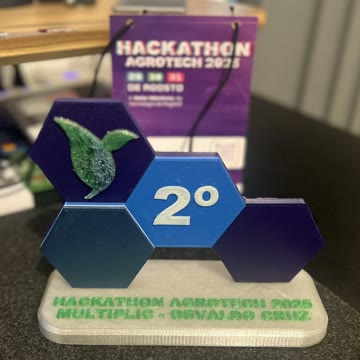
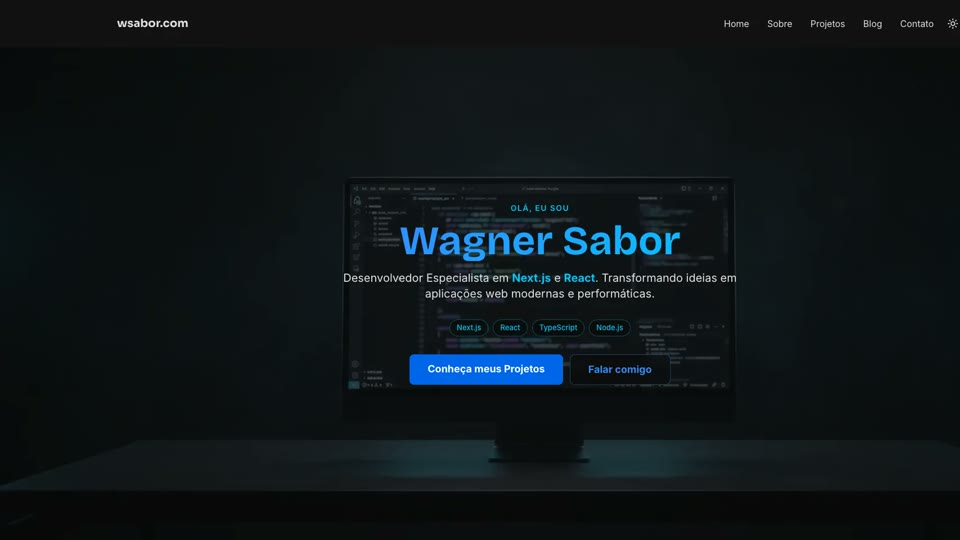
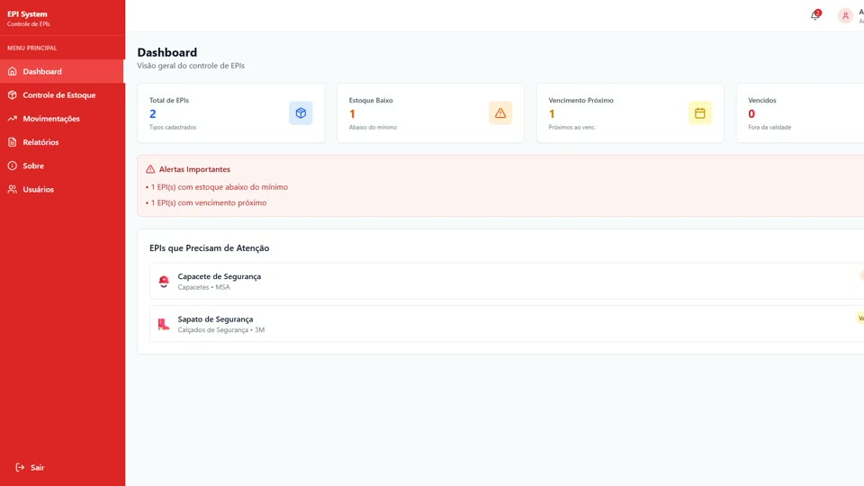
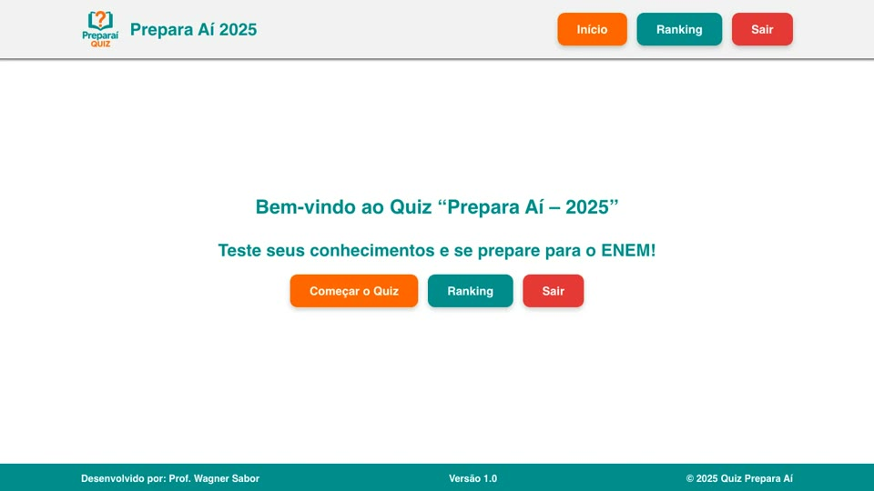
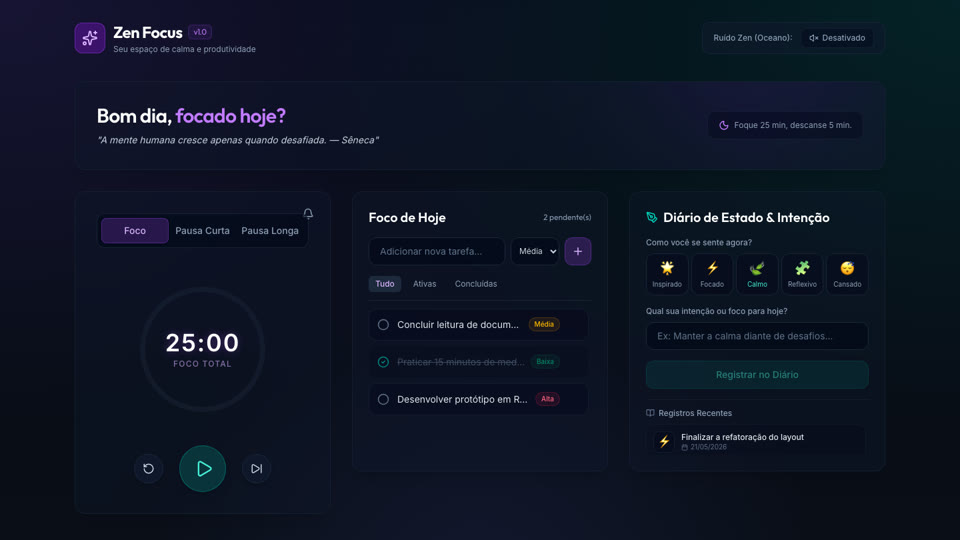
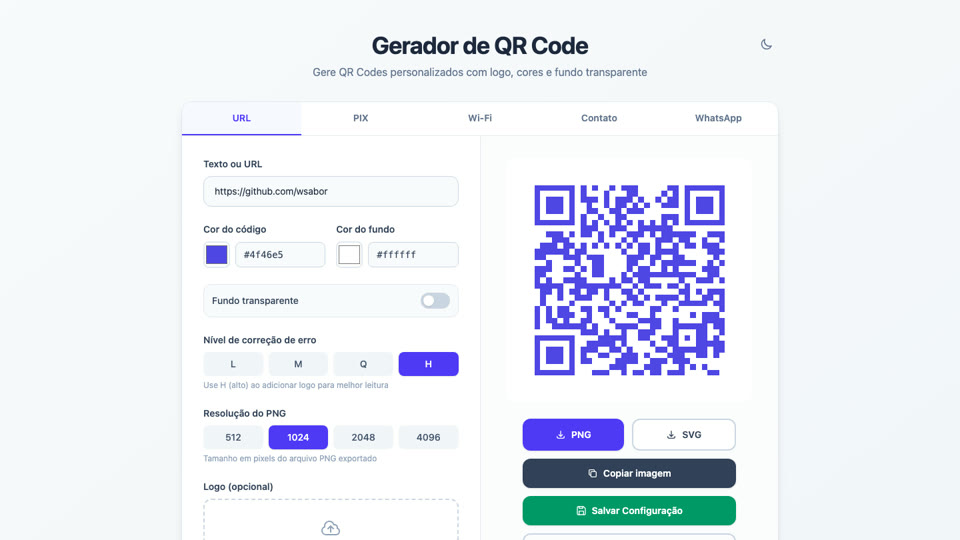
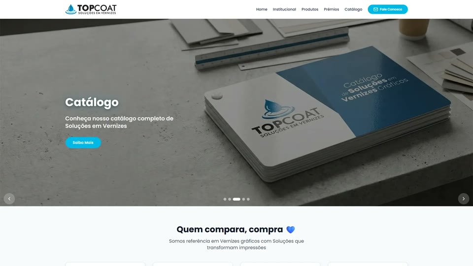
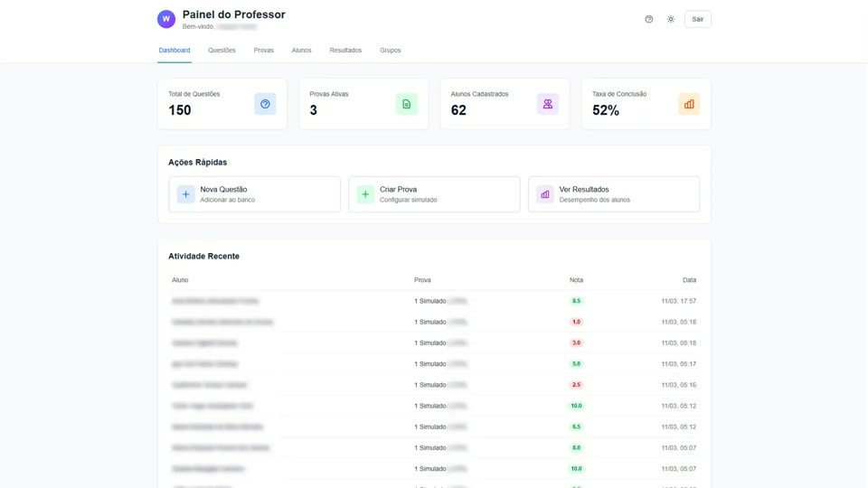
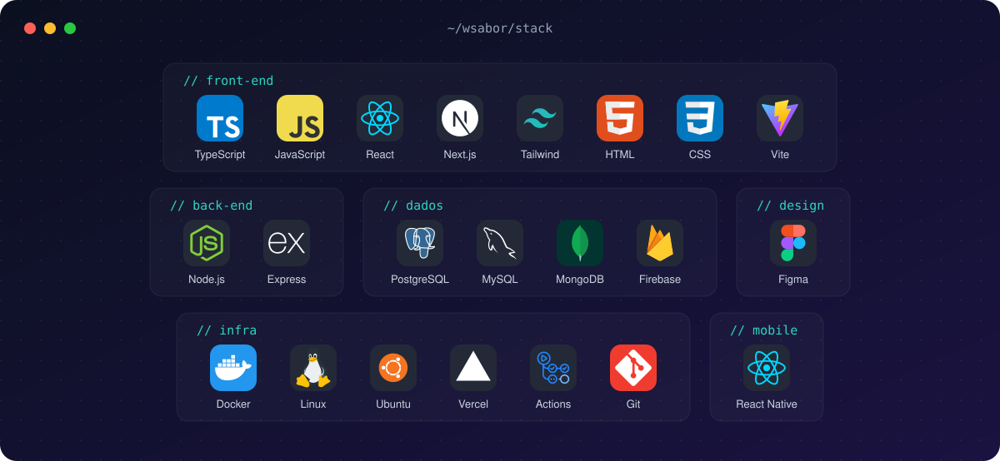

  
  
  

  

Desenvolvedor web vindo do design gráfico e instrutor no Curso Técnico em Desenvolvimento de Sistemas do SENAI-SP. Construo aplicações completas com Next.js, React e Node.js, da interface ao servidor, e uso esses mesmos projetos para ensinar.

> 🇺🇸 _Web developer and software development instructor in São Paulo, Brazil. Designer turned developer, building full-stack apps with TypeScript, React and Node.js._

## Sobre mim

Comecei na área gráfica, diagramando livros, revistas e jornais e atendendo clientes direto. Em 2011 passei para a tecnologia, primeiro em freelas e no trabalho da época, e depois fiz Informática para Negócios na FATEC de São Bernardo do Campo.

Do design ficou o hábito de pensar em quem vai usar antes de escrever a primeira linha. Hoje uno as duas coisas: interfaces cuidadas e código sólido, do Figma ao deploy.

No SENAI-SP formo técnicos em Desenvolvimento de Sistemas. Levo para a sala o que uso nos meus projetos, e boa parte do material das unidades curriculares está aberta aqui no GitHub.

- 🧑‍🏫 Instrutor de Formação Profissional no SENAI-SP
- 🥈 2º lugar no Hackathon Agrotech 2025 com uma equipe de alunos
- 🤖 IA generativa no dia a dia de desenvolvimento e na preparação de aulas
- 🖨️ Nas horas vagas, impressão 3D com uma Ender 3 V3 SE

> 🇺🇸 _Started in graphic design, laying out books, magazines and newspapers, and moved into tech in 2011, later earning a degree in IT for Business at FATEC. Today I teach Systems Development at SENAI-SP and bring the tools from my own projects into the classroom. On the side: generative AI and 3D printing._

 

## Destaques

> 🇺🇸 _2nd place at Hackathon Agrotech 2025, mentoring a team of nine students, and five Microsoft Fundamentals certifications (Azure, AI, Data, Security and Power Platform)._

<table>
  <tr>
    <td width="200" valign="top">
      
    </td>
    <td valign="top">
      <b>🥈 Hackathon Agrotech 2025</b>  
      Montei e orientei uma equipe de nove alunos no meu primeiro hackathon. Chegamos com ideias de programação e descobrimos que o desafio era outro: entender a dor do produtor rural, validar com quem é do setor e entregar um MVP com pitch em dois dias. O projeto <a href="https://agrosolutio.vercel.app">Agro Solutio</a> ficou em 2º lugar.  
      <a href="https://wsabor.com/blog/hackaton-agrotech-2025">Ler o relato completo →</a>
    </td>
  </tr>
</table>

**Certificações Microsoft**

  
  
  
  
  

## Projetos

> 🇺🇸 _Selected work: my website and blog, a PPE inventory system, a scroll-driven landing page study, an exam-prep quiz built with students, a focus app with generated ambient sound and a QR code generator PWA._

<table>
  <tr>
    <td width="50%" valign="top">
      
      <h3>wsabor.dev</h3>
      Meu site e blog. Artigos em MDX com componentes React, hero com sequência de imagens controlada pelo scroll, tema claro e escuro.  
           
      <a href="https://github.com/wsabor/wsabor.dev">Código</a> · <a href="https://wsabor.com">Ver online</a>
    </td>
    <td width="50%" valign="top">
      
      <h3>EPI System</h3>
      Gestão de Equipamentos de Proteção Individual: estoque, entregas rastreáveis com histórico imutável, relatórios e auditoria. Feito para rodar na infraestrutura de quem usa.  
           
      <a href="https://github.com/wsabor/epi-system">Código</a>
    </td>
  </tr>
  <tr>
    <td width="50%" valign="top">
      
      <h3>Hotel Brisa do Mar</h3>
      Projeto de estudo: landing page em que a "câmera" entra no hotel conforme a página rola. Sequência de quadros em canvas, smooth scroll e alternativa estática para quem prefere menos movimento.  
          
      <a href="https://github.com/wsabor/brisa-mar-hotel">Código</a> · <a href="https://brisa-mar-hotel.wsabor.dev">Ver online</a>
    </td>
    <td width="50%" valign="top">
      
      <h3>Preparaí 2025</h3>
      Quiz de preparação para o ENEM com pontuação e ranking, desenvolvido com uma turma de Projetos de Software, da UX ao back-end.  
          
      <a href="https://github.com/wsabor/preparai2025">Código</a> · <a href="https://preparai2025.vercel.app">Ver online</a>
    </td>
  </tr>
  <tr>
    <td width="50%" valign="top">
      
      <h3>Zen Focus</h3>
      Pomodoro, lista de tarefas e diário de intenção. O som ambiente de ondas é gerado na hora pela Web Audio API, sem arquivos de áudio.  
          
      <a href="https://github.com/wsabor/ZenFocus">Código</a>
    </td>
    <td width="50%" valign="top">
      
      <h3>Gerador de QR Code</h3>
      QR Codes para URL, PIX, Wi-Fi, contato e WhatsApp, com logo, cores e exportação em PNG ou SVG. Funciona como PWA, inclusive offline.  
          
      <a href="https://github.com/wsabor/qrcode">Código</a> · <a href="https://qrcode-green-mu.vercel.app">Ver online</a>
    </td>
  </tr>
</table>

### Para clientes e para a escola

> 🇺🇸 _Client and school work: a bilingual corporate website and a platform for running mock exams in class._

<table>
  <tr>
    <td width="50%" valign="top">
      
      <b>Topcoat Vernizes</b> 
      Site institucional em português e espanhol, com detecção automática de idioma. Next.js e Tailwind CSS. 
      <a href="https://topcoatvernizes.com.br">Ver online</a>
    </td>
    <td width="50%" valign="top">
      
      <b>Sistema de Simulados e Provas</b> 
      Plataforma para aplicar simulados e provas em sala de aula. Next.js e Tailwind CSS. 
      <a href="https://simulado.wsabor.dev">Ver online</a>
    </td>
  </tr>
</table>

## Na sala de aula

Material e projetos que uso com as turmas do técnico, abertos para quem quiser estudar ou adaptar:

- 📚 [programacao-backend](https://github.com/wsabor/programacao-backend): atividades e exercícios da UC de Programação Back-End
- 🔔 [notificacoes-api](https://github.com/wsabor/notificacoes-api): API REST de notificações por e-mail, usada como situação de aprendizagem
- 🛡️ [squid](https://github.com/wsabor/squid): proxy em modo whitelist para o laboratório, pronto para outras unidades adaptarem
- 📊 [sistema-notas](https://github.com/wsabor/sistema-notas): cálculo de médias e classificação de alunos em C++, no terminal

> 🇺🇸 _Course material and projects I use with my students, open for anyone to study or adapt: back-end exercises, a REST API for email notifications, a whitelist proxy for the school lab and a C++ grading app._

## Stack

> 🇺🇸 _Tools I use day to day, from the interface to the deploy._

## Atividade

> 🇺🇸 _Contribution streak and most used languages._

  <picture>
    <source media="(prefers-color-scheme: dark)" srcset="https://streak-stats.demolab.com?user=wsabor&theme=github-dark-blue&hide_border=true&background=0D1117&ring=6366F1&fire=2DD4BF&currStreakLabel=2DD4BF&locale=pt_BR">
    
  </picture>
  <picture>
    <source media="(prefers-color-scheme: dark)" srcset="https://github-readme-stats.vercel.app/api/top-langs?username=wsabor&layout=compact&langs_count=6&hide_border=true&bg_color=0D1117&title_color=2DD4BF&text_color=C9D1D9&custom_title=Linguagens%20mais%20usadas">
    
  </picture>

